<!-- ASCII Profile Card (Dark/Light Responsive, animated via animate_card.py) -->
<picture>
  <source media="(prefers-color-scheme: dark)" srcset="dark_mode.svg" />
  <source media="(prefers-color-scheme: light)" srcset="light_mode.svg" />
  
</picture>

 

<!-- Infinite blurred glow reveal bar, sweeping left -> right -->

  
<!-- Animated header (dark / light) -->
<picture>
  <source media="(prefers-color-scheme: dark)" srcset="header_dark.svg" />
  <source media="(prefers-color-scheme: light)" srcset="header_light.svg" />
  
</picture>

<!-- About Me (animated cards, dark / light) -->

<picture>
  <source media="(prefers-color-scheme: dark)" srcset="about_dark.svg" />
  <source media="(prefers-color-scheme: light)" srcset="about_light.svg" />
  
</picture>

<!-- 🌐 SOCIALS (premium single row, border top + bottom) -->

  ### 🌐 Connect With Me / Socials</h2>
  
  ---
   

  <table width="100%">
    <tr>
      <td align="center" width="12.5%">
        
      </td>
      <td align="center" width="12.5%">
        
      </td>
      <td align="center" width="12.5%">
        
      </td>
      <td align="center" width="12.5%">
        
      </td>
      <td align="center" width="12.5%">
        
      </td>
      <td align="center" width="12.5%">
        
      </td>
      <td align="center" width="12.5%">
        
      </td>
      <td align="center" width="12.5%">
        
      </td>
    </tr>
  </table>

---

### ⚡ Tech Arsenal & Capabilities

---

   

  <!-- 💻 LANGUAGES -->
  
<b>💻 Languages</b>

  

    

  <!-- 🎨 FRONTEND -->
  
<b>🎨 Frontend</b>

  
    
  

    

  <!-- ⚙️ BACKEND & DATABASES -->
  
<b>⚙️ Backend &amp; Databases</b>

  
    
  
  
  

    

  <!-- 🛠️ TOOLS, EDITORS & DEPLOYMENT -->
  
<b>🛠️ Tools, Editors &amp; Deployment</b>

  
    
  
  

---

  ### 📊 GitHub Activity & Metrics

---

   

  <!-- STATS & STREAK CARDS -->
  
  

    

  <!-- CONTRIBUTION ACTIVITY GRAPH -->
  <a href="https://github.com/Abinashrout244">
    

  

  Crafted with passion by <a href="https://github.com/Abinashrout244">Abinash Rout</a>

